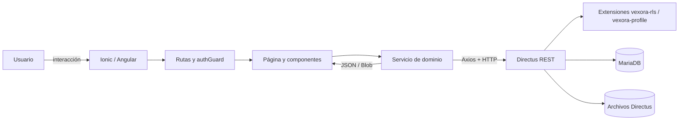
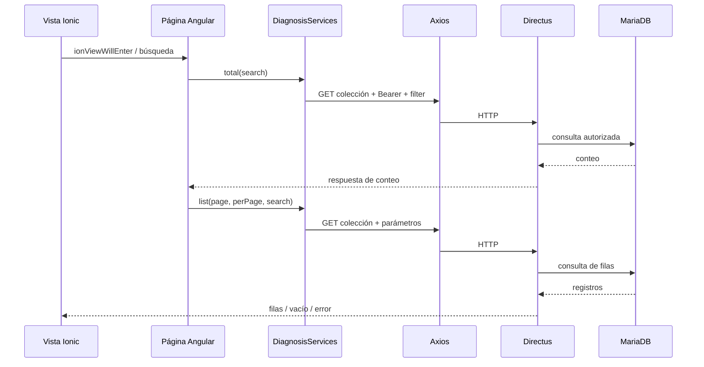

# Manual de estudio y defensa de VEXORA

## Alcance, fecha lógica y cómo utilizar la guía

Este manual describe el código de VEXORA que está en esta copia de `docker_moviles/`, incluida la aplicación Ionic, los servicios que consultan Directus y las extensiones del proyecto. Las rutas que aparecen se expresan desde la raíz del repositorio. El objetivo es que puedas seguir cada recorrido en el código y explicar sus decisiones, no sustituir una revisión de la instancia desplegada.

**Límite de las fuentes académicas.** Los manuales originales del profesor no están disponibles en el árbol local de esta copia. Por eso no reproduzco ni atribuyo procedimientos, ejemplos o reglas exactas a esos documentos. La petición previa identificó los manuales 08 y 11 como referencias para paginación y servicios, y las adaptaciones realizadas se pueden localizar en el código; sin el texto original no es posible verificar sus ejemplos frase por frase. En una defensa, presenta esa diferencia con transparencia y lleva los manuales originales para completar la comparación.

**Límite de ejecución.** Una lectura del repositorio no prueba la configuración activa de un servidor Directus ni la configuración de permisos almacenada en su base de datos. Tampoco equivale a una prueba funcional en teléfono. Este manual describe contratos y controles que sí se observan en código y distingue las limitaciones.

## Índice

1. Introducción, problema y objetivos
2. Arquitectura general
3. Repositorio y organización de carpetas
4. Angular, Ionic y ciclo de una página
5. Módulos, componentes, rutas y páginas
6. Servicios y comunicación con Directus
7. Inicio de sesión, tokens, guardias y permisos
8. Módulos funcionales de VEXORA
9. Formularios, altas, ediciones y validación
10. Búsqueda, listados y paginación
11. Diagnósticos, evidencias y miniaturas
12. Directus, MariaDB y Docker
13. Herencia, adaptaciones, estudio y defensa académica

Glosario y preguntas de estudio están incluidos en el capítulo 13.

## 1. Introducción, problema y objetivos

VEXORA organiza información y operaciones de un taller mecánico. La aplicación móvil ofrece pantallas para catálogos, clientes y vehículos, citas, órdenes de trabajo, diagnósticos, evidencias, historial, cotizaciones, pagos y perfil. La interfaz está construida con Ionic y Angular; la API de datos es Directus y el motor relacional configurado en el entorno es MariaDB.

El objetivo técnico es separar responsabilidades: una página coordina la pantalla y sus estados, un servicio encapsula las llamadas a la API, Directus aplica su modelo de colecciones y permisos, y MariaDB conserva los datos. Docker Compose describe los servicios que colaboran durante el desarrollo.

Al estudiar una característica, sigue esta secuencia: encuentra la ruta, abre el módulo y la página, identifica el servicio inyectado, comprueba la URL y los parámetros de Axios, y finalmente revisa en Directus la colección o extensión pertinente. No deduzcas el nombre de un endpoint a partir del nombre de una pantalla: puede haber singular/plural distintos, por ejemplo la página de evidencias usa la colección `evidence`.

## 2. Arquitectura general



### Responsabilidad por capa

* **Interfaz Ionic/Angular:** presenta formularios y resultados, recibe eventos y mantiene estados como cargando, vacío o error. El diseño y los textos viven en HTML y SCSS de cada página y sus componentes.
* **Rutas Angular:** enlazan una URL con un módulo cargado de forma diferida. Las rutas privadas pueden incorporar metadatos para `authGuard`.
* **Servicios:** forman las peticiones Axios, adjuntan el token cuando corresponde y exponen `Observable` de RxJS con los datos de `response.data.data`.
* **Directus:** expone REST sobre colecciones, archivos y autenticación. Sus permisos y extensiones son parte de la seguridad del servidor.
* **MariaDB y almacenamiento de archivos:** sostienen datos relacionales y archivos. Una referencia de archivo no es el contenido binario; el cliente obtiene la miniatura protegida aparte.

La separación no significa que toda página use un patrón idéntico. La aplicación contiene flujos sencillos de catálogo y otros de negocio, como cotización, orden de trabajo o carga de archivos, que necesitan coordinaciones propias.

## 3. Repositorio y organización de carpetas

La raíz incluye `mobile/` (aplicación Ionic), `directus/` (extensiones propias), `database/`, `docs/` y `docker-compose.yml`. La guía se concentra en el código existente; no propone reorganizarlo.

En `mobile/src/app/`:

* `pages/` agrupa pantallas por dominio y normalmente separa `list/`, `detail/` y `form/`. Cada vista puede incluir `.page.ts`, `.page.html`, `.page.scss`, `.module.ts` y `.routing.module.ts`.
* `services/` contiene servicios de acceso a la API por dominio: por ejemplo `mobile/src/app/services/brands/brands.ts` y `mobile/src/app/services/diagnoses/diagnoses.ts`.
* `components/` contiene piezas compartidas como `toolbar/`, `searchbar/` y `pagination/`.
* `guard/auth-guard.ts` implementa la protección de rutas.
* `constants/` contiene `roles.ts`, `view_access.ts`, `role_actions.ts` y `admin_menu.ts`.
* `tabs/` contiene la navegación de pestañas; el archivo real es `mobile/src/app/tabs/tabs.page.ts`, no está bajo `pages/`.
* `app-routing.module.ts` define las rutas principales y sus metadatos de acceso.
* `src/environments/environment.ts` y `environment.prod.ts` definen las URL base de API y autenticación.

El archivo marcador `.ionic-setup-complete` está versionado en el repositorio. El `mobile/Dockerfile` contiene una rama condicional que ejecuta la preparación inicial cuando ese archivo no está en `/app`; si el marcador está presente en una clonación, esa rama no se activa. El marcador no es un secreto ni una instrucción de Git ignorada. Este comportamiento corresponde al Dockerfile y a la presencia efectiva del marcador en el contexto de construcción; no se debe borrar para “forzar” una inicialización sin entender qué copia o instala el Dockerfile.

## 4. Angular, Ionic y ciclo de una página

Las páginas revisadas están declaradas con `standalone: false` y usan módulos Angular. Ionic añade componentes como `ion-content`, `ion-button`, `ion-input`, `ion-modal` y eventos de ciclo de página como `ionViewWillEnter`.

El enrutamiento usa carga diferida (`loadChildren`) para importar el módulo de una pantalla cuando se visita su ruta. Esto mantiene el diseño de módulos existente. No es una aplicación migrada por completo a componentes standalone.

En listas que deben refrescarse al regresar a una pestaña o modal, `ionViewWillEnter()` vuelve a pedir los datos. El evento Angular `ngOnInit()` tiene otro propósito: inicializar una instancia de componente. Si ambos disparan la misma consulta al abrir por primera vez, el resultado es una doble petición. La corrección autorizada para diagnósticos deja la carga de esa lista únicamente en `ionViewWillEnter()`; las recargas tras guardar también llaman explícitamente a `chargerDiagnoses()`.

### Formas reactivas

Los formularios observados importan `FormBuilder`, `FormGroup` y `Validators`; la cotización también importa `FormArray`. No se identificó uso de la clase `FormControl` en las páginas de la aplicación. `FormBuilder.group(...)` crea controles y grupos internamente, pero eso no significa que el archivo use explícitamente `new FormControl(...)`. Al documentar una forma, nombra las clases que aparecen en su código.

## 5. Módulos, componentes, rutas y páginas

### Rutas y navegación

`mobile/src/app/app-routing.module.ts` asocia rutas como `brands/list`, `vehicles/form`, `diagnoses/detail/:id` y `evidences/list` con módulos cargados de forma diferida. Para rutas protegidas se agrega el resultado de `viewRoute(...)`, que coloca datos de acceso para la guardia. Login y registro son públicos; `forbidden` presenta acceso denegado.

La navegación de pestañas está en `mobile/src/app/tabs/tabs.page.ts`: filtra las pestañas disponibles de acuerdo con el rol. La guardia y la configuración de pestañas son controles de navegación diferentes; ocultar una pestaña no sustituye la comprobación de ruta ni los permisos del backend.

### Componentes reutilizables

* `mobile/src/app/components/toolbar/toolbar.component.ts`, plantilla y SCSS: barra de herramientas compartida donde se importa.
* `mobile/src/app/components/searchbar/searchbar.component.ts`: selector `app-searchbar`; recibe opciones de presentación y emite `changeText` tras la búsqueda/debounce definido por el componente.
* `mobile/src/app/components/pagination/pagination.component.ts`: selector `app-pagination`; recibe total, tamaño de página y página actual, y emite `changePage`.

Los módulos de las listas importan los módulos compartidos que necesitan. No se debe cambiar el contrato de estos componentes solo para ajustar una pantalla.

### Inventario funcional de páginas

Los dominios siguientes se observan en `mobile/src/app/pages/`; esta lista describe su responsabilidad prevista y los flujos que efectivamente existen, no afirma que cada dominio tenga un CRUD completo.

| Dominio | Organización/relación principal | Servicio relacionado |
|---|---|---|
| `brands` | Lista, detalle y formulario de marcas; catálogo que se relaciona con modelos. | `mobile/src/app/services/brands/brands.ts` (`BrandServices`) |
| `colors` | Catálogo de colores utilizado por vehículos. | `mobile/src/app/services/colors/colors.ts` (`ColorServices`) |
| `fuels` | Catálogo de combustibles utilizado por vehículos. | `mobile/src/app/services/fuels/fuels.ts` (`FuelServices`) |
| `methods` | Catálogo de métodos de pago. | `mobile/src/app/services/methods/methods.ts` (`MethodServices`) |
| `models` | Modelos asociados a una marca; su detalle consulta también la marca. | `mobile/src/app/services/models/models.ts` (`ModelServices`) |
| `parts` | Catálogo de piezas utilizado al preparar partidas de cotización. | `mobile/src/app/services/parts/parts.ts` (`PartServices`) |
| `services` | Catálogo de servicios que puede integrar una cotización. | `mobile/src/app/services/services/services.ts` (`ServiceServices`) |
| `vehicles` | Vehículos del sistema; se relacionan con propietario, modelo, combustible y color. | `mobile/src/app/services/vehicles/vehicles.ts` (`VehicleServices`) |
| `appointments` | Citas vinculadas a vehículos y estados; incluye lista, detalle, formulario y confirmación. | `mobile/src/app/services/appointments/appointments.ts` (`AppointmentServices`) |
| `workorders` | Órdenes vinculadas con vehículo, estado y personal asignado; punto de unión con diagnóstico, evidencia y cotización. | `mobile/src/app/services/workorders/workorders.ts` (`WorkorderServices`) |
| `diagnoses` | Diagnósticos asociados a una orden de trabajo, con descripción y resultado. | `mobile/src/app/services/diagnoses/diagnoses.ts` (`DiagnosisServices`) |
| `evidence` | Registros de evidencia relacionados con orden/archivo. El endpoint de colección es singular. | `mobile/src/app/services/evidences/evidences.ts` (`EvidenceServices`) |
| `history` | Consulta de historial de vehículo/orden; el formulario local está vacío/incompleto y no se documenta como alta funcional. | `mobile/src/app/services/history/history.ts` (`HistoryServices`) |
| `quotes` | Cotización con servicios y piezas mediante partidas relacionadas. | `mobile/src/app/services/quotes/quotes.ts` (`QuoteServices`) |
| `users` | Administración de usuarios y roles según la pantalla y permisos disponibles. | Operaciones de usuario en `mobile/src/app/services/auth/auth.ts` |
| `payment` | Operaciones de pago asociadas a cotización y método de pago. | `mobile/src/app/services/payments/payments.ts` (`PaymentServices`) |
| `profile` | Consulta/edición del perfil y avatar. | `AuthService` en `mobile/src/app/services/auth/auth.ts` |
| `login` | Inicio de sesión y recuperación de retorno de ruta. | `AuthService` |
| `register` | Registro de usuario. | `AuthService` |
| `forbidden` | Informa que la ruta fue denegada; no concede permiso. | No requiere servicio de colección para su función principal. |

Rutas de detalle/formulario existentes no garantizan que todas las operaciones estén disponibles para todos los roles. Revisa tanto el guard, el código de página y el servicio como los permisos Directus.

## 6. Servicios y comunicación con Directus

Los servicios se encuentran en `mobile/src/app/services/`. Entre los nombres reales: `BrandServices`, `ColorServices`, `FuelServices`, `MethodServices`, `ModelServices`, `PartServices`, `ServiceServices`, `DiagnosisServices`, `EvidenceServices`, `HistoryServices`, `VehicleServices`, `AppointmentServices`, `WorkorderServices`, `QuoteServices`, `QuoteitemServices`, `QuotepartServices`, `PaymentServices` y `AuthService`.

En los servicios de colección se observa Axios para HTTP y operadores RxJS como `defer`, `map` y `Observable`. `defer` hace que la función que contiene la petición se ejecute cuando se suscribe al observable. `map` transforma la envoltura habitual de Directus `response.data.data` en el tipo que consume la página. En las páginas se usa `firstValueFrom(...)` cuando se necesita esperar una sola respuesta en una función `async`.

Ejemplo real, reducido al patrón presente en `mobile/src/app/services/diagnoses/diagnoses.ts`:

```ts
return defer(() => axios.get<{ data: Diagnosis[] }>(this.url, {
  ...this.getAuthConfig(),
  params: { page, limit: perPage, sort: 'id', ...this.filter(search) }
})).pipe(map(response => response.data.data));
```

El servicio define `this.url` con `environment.apiUrl + '/diagnoses'`; el token se lee de `AuthService.getAccessToken()` y se envía como `Authorization: Bearer ...`. Los parámetros `page`, `limit`, orden y filtro son parte de esa petición. No inventes un endpoint para un método: abre su implementación y verifica la ruta final.

### Métodos de servicios relevantes

Los servicios de catálogo contienen, según la entidad, métodos `list`, `listWithOutFilters`, `detail`, `create`, `update`, `delete` y `total`. Por ejemplo `DiagnosisServices` expone además `ofWorkorder(id)` y `EvidenceServices` contiene `upload(...)`, `assetUrl(...)` y `assetObjectUrl(...)`. `QuoteitemServices` y `QuotepartServices` atienden sus entidades de detalle y tienen operaciones vinculadas a una cotización. `AppointmentServices` expone operaciones específicas de cita como `executeCancelAppointment(...)`.

`HistoryServices` en `mobile/src/app/services/history/history.ts` tiene el método `list()` para encapsular la lectura de historial. Conserva `environment.apiUrl + '/history'`, el token Bearer y el mapeo de respuesta. La página `history/list/list.page.ts` presenta los datos; la petición ya no queda escrita directamente dentro de esa página. El servicio no inventa una ruta de creación.

### Errores y estados

Axios rechaza la promesa cuando la petición falla. La capa de página debe decidir qué estado mostrar. Un `try/catch/finally` permite activar carga, representar error y apagar el indicador incluso tras fallo. No confundas `total = 0` por respuesta válida vacía con `total = 0` porque falló la red; en el segundo caso debe conservarse un indicador de error.

## 7. Inicio de sesión, tokens, guardias y permisos

### Sesión

`AuthService` está en `mobile/src/app/services/auth/auth.ts`. Entre sus métodos visibles están `signin`, `register`, `active`, `renew`, `validateSession`, `getProfile`, `updateProfile`, `uploadAvatar`, `assetObjectUrl`, `getPermissions`, `loadUserContext`, `getCurrentProfile`, `getRole`, `getID`, `getAccessToken`, `hasRole`, `can`, `getAccess`, `logout`, `listUsers`, `getMechanicList`, `listRoles`, `getUser`, `createUser` y `updateUser`.

El token de sesión se conserva en el estado del servicio en memoria, no en `localStorage`. `signin` solicita autenticación, y `renew` utiliza `environment.authUrl + '/auth/refresh'`; las dos variantes de entorno declaran `authUrl`. Esta ruta separa el host de autenticación del host base de colecciones (`apiUrl`, que ya incluye `/items`). Cambiar un host exige comprobar sus valores; aquí se describe la corrección autorizada ya aplicada.

### Guardia de navegación

`mobile/src/app/guard/auth-guard.ts` exporta `authGuard`, una `CanActivateFn` que:

1. Ejecuta `validateSession()`.
2. Si la sesión no es válida, crea una ruta a `/login` con `returnUrl`.
3. Llama a `loadUserContext()` para cargar contexto/permisos.
4. Si la ruta declara `roles`, compara con `getRole()`.
5. Si declara `permission`, consulta `auth.can(collection, action)`.
6. En acceso denegado dirige a `/forbidden`; ante excepción también rechaza la ruta.

### Acceso por vistas y acciones

Los nombres exactos son `mobile/src/app/constants/view_access.ts` y `mobile/src/app/constants/role_actions.ts`. `roles.ts` contiene las constantes de roles. El primero expresa roles admitidos para vistas; el segundo expresa roles para acciones de negocio (por ejemplo crear/cancelar citas o agregar diagnóstico/evidencia a una orden). `tabs.page.ts` filtra opciones de tab según rol. Estas reglas del cliente organizan la interfaz y navegación, pero no sustituyen la política del servidor.

Las extensiones Directus `vexora-rls` y `vexora-profile` son parte del control en backend. La efectiva configuración de roles/policies de la instancia también depende de los datos configurados en Directus. No se debe afirmar que una fila concreta está protegida solo porque un botón se oculta.

## 8. Módulos funcionales de VEXORA

Este capítulo amplía el inventario del capítulo 5 mostrando las conexiones del negocio. El punto de entrada exacto de cada módulo es su ruta en `mobile/src/app/app-routing.module.ts`; el directorio de página y el servicio asociado se indican en la tabla anterior.

### Catálogos

Marcas, colores, combustibles, métodos, modelos, piezas y servicios alimentan formularios y operaciones de negocio. En catálogos autorizados de la interfaz se puede consultar, crear y editar según la pantalla y el rol. Los listados de brands/colors/models/parts/services recargan tanto filas como conteo al cerrar con resultado guardado. Las cinco páginas autorizadas de detalle usan sus servicios ya existentes: marcas, colores, combustibles, métodos y modelos invocan `detail(id)`; el detalle de modelo además carga su marca. No se ha trasladado esa lógica a una arquitectura nueva.

### Vehículos y citas

Los formularios de vehículo consumen catálogos y relacionan el registro con sus referencias. Citas trabajan con usuario/vehículo/estado y tienen funciones de alta, consulta y acciones específicas como cancelar; la implementación concreta decide qué roles pueden realizar cada acción.

### Órdenes, diagnósticos y evidencias

La orden de trabajo es el contexto donde se documenta el trabajo. Un diagnóstico registra descripción y resultado vinculado a `workorder_id`. Una evidencia asocia el registro de archivo con la orden. Ambos pueden ser consultados por sus pantallas/servicios y contribuyen al expediente del trabajo.

### Cotizaciones y pagos

La cotización compone el importe a través de partidas relacionadas con servicios y piezas. `QuoteitemServices` y `QuotepartServices` comunican las entidades de partida. El módulo de pago usa `PaymentServices` y se relaciona con el método de pago/cotización. No confundas pago con la lista del catálogo de métodos.

### Usuarios, perfil, historial y acceso denegado

La administración de usuarios se apoya en operaciones de AuthService; la persona puede editar datos de perfil y avatar. Historial presenta datos de vehículos/órdenes desde consulta de lista; su formulario de vista existe en el árbol, pero está vacío/incompleto y no debe exponerse como un flujo de registro implementado. La página forbidden informa un rechazo de acceso.

El módulo `login` autentica; `register` solicita registro. En rutas de acceso denegado no se debe reenviar a una página que permita eludir el guard.

## 9. Formularios, altas, ediciones y validación

Los formularios usan Angular Reactive Forms. El patrón típico inyecta `FormBuilder`, crea un `FormGroup` con `formBuilder.group(...)`, aplica `Validators` y al guardar llama al servicio `create` o `update` según exista el identificador. Al abrir un formulario desde lista, algunas pantallas lo presentan como modal; la página lista escucha el resultado del cierre y vuelve a cargar cuando recibe `saved`.

No se debe generalizar una regla de validación a todo el sistema: cada formulario define sus propias reglas. Ejemplos observables incluyen `required`, `email`, `minLength`, `maxLength`, `min`, `max` y `pattern`. En vehículos se validan campos como placa, año y VIN; en catálogos se requieren nombres y se validan longitudes/precios; login exige correo y contraseña.

### Relaciones

Una relación Directus puede presentarse como un identificador o una relación expandida. El formulario de vehículo carga catálogos para elegir marca/modelo, combustible y color; el detalle de modelo carga la marca relacionada con `BrandServices.detail(...)`. Una orden de trabajo se relaciona con vehículo y puede estar vinculada a mecánico/estado. Una cotización relaciona la orden y contiene partidas de servicios y piezas.

Comprueba el tipo de respuesta en la interfaz de servicio y la forma de construir el formulario antes de explicar cardinalidad o integridad. La validación de cliente mejora la entrada, pero no reemplaza validaciones y permisos del servidor.

### FormArray en cotizaciones

`mobile/src/app/pages/quotes/form/form.page.ts` declara `items` y `parts` como arreglos del formulario. Sus getters `items` y `partsArray` devuelven `FormArray`; `createItem()` genera un `FormGroup` para una línea de servicio y `createPart()` uno para pieza/cantidad. Métodos `addService` y `addPart` incorporan grupos y las rutinas de cálculo actualizan subtotal, impuesto y total. La tasa observada en la clase es `0.16`. Al defender importes, indica que es la regla de esa página; no la presentes como una regla fiscal universal.

## 10. Búsqueda, listados y paginación

La búsqueda compartida se representa con `app-searchbar` y la paginación con `app-pagination`, módulos en `mobile/src/app/components/searchbar/` y `components/pagination/`. El servicio recibe búsqueda como argumento y genera el filtro de Directus. La lista usa `list(page, perPage, search)`; el conteo usa `total(search)`. Deben compartir el mismo texto/criterio para que cantidad de páginas y filas describan el mismo conjunto.

En diagnósticos y evidencias VEXORA usa `perPage = 5`. Los servicios aceptan esos argumentos y envían `page`/`limit`; `total(search)` solicita el agregado. En la implementación original el paginador compartido y las operaciones `list`/`total` ya existían, pero el valor 5 de la pantalla es una decisión de VEXORA, no una cifra fija que deba atribuirse al proyecto original. En el original algunos valores por defecto de servicio y componente son distintos.

Secuencia al escribir una búsqueda:

1. `app-searchbar` emite el texto.
2. El handler de la página conserva el texto y reinicia `currentPage` a 1.
3. La página solicita el conteo con ese filtro.
4. Corrige la página seleccionada si el total ya no alcanza la página previa.
5. Solicita las filas con el mismo filtro, número de página y tamaño.
6. Presenta resultados, estado vacío o error.

Al seleccionar página, `changePage(page)` solicita solo ese segmento. Una respuesta válida sin coincidencias muestra estado vacío con total cero; fallo de conteo no debe tratarse como búsqueda vacía. En diagnósticos, la carga inicial ahora se dispara desde `ionViewWillEnter()` una vez por entrada y el fallo de conteo termina el ciclo en estado de error sin lanzar una consulta de filas basada en un conteo ficticio.

Los filtros exactos están en los servicios: `DiagnosisServices.filter` compara texto en `description` o `result`; `EvidenceServices.filter` construye su criterio sobre los campos de evidencia de la implementación. No reconstruyas ese filtro de memoria para explicar una consulta, abre `mobile/src/app/services/diagnoses/diagnoses.ts` o `mobile/src/app/services/evidences/evidences.ts`.

## 11. Diagnósticos, evidencias y miniaturas

### Diagnóstico

`DiagnosisServices` define `Diagnosis` y `DiagnosisCreate`, y usa la colección `/diagnoses`. Sus métodos visibles incluyen `list`, `listWithOutFilters`, `detail`, `create`, `update`, `delete`, `total` y `ofWorkorder`. `list` prepara paginación, orden y filtro; `total` agrega el conteo con el mismo helper `filter(search)`. La página `mobile/src/app/pages/diagnoses/list/list.page.ts` coordina los estados `loading`, `loadError`, `currentPage`, `perPage`, `search` y `diagnoses`, y sus modales de alta/edición recargan tras `saved`.

### Evidencia y archivo

`EvidenceServices` usa la colección `/evidence` y la API de archivos Directus. `upload(workorderId, file)` implementa la carga/creación relacionada; `assetObjectUrl(fileId)` solicita el recurso de archivo con autorización y obtiene un `Blob` para generar una URL temporal de navegador. La página y el HTML muestran miniaturas a partir de esas URLs. Cuando sustituye resultados, la interfaz revoca URLs previas con `URL.revokeObjectURL(...)` para soltar los recursos temporales.

La autenticación se conserva al obtener el blob mediante la cabecera Bearer. No es equivalente a hacer la URL de archivo pública. El servicio admite tipos específicos de imagen según su validación de carga; aceptar HEIC/HEIF no garantiza que todos los navegadores puedan decodificarlo como miniatura. La interfaz debe conservar su estado de error/fallback.

La carga también tiene límites definidos por el código de formulario. Para defender formatos y tamaño exacto, verifica las condiciones en `mobile/src/app/services/evidences/evidences.ts` y `mobile/src/app/pages/evidence/form/form.page.ts`, porque la validación puede estar repartida entre servicio y página.

## 12. Directus, MariaDB y Docker

`docker-compose.yml` declara el entorno colaborativo. Los servicios incluyen MariaDB, Directus (`api`), la aplicación Ionic (`mobile`) y herramientas auxiliares de documentación/administración. La API se publica como puerto de host 8000 y Ionic como 8100; otros puertos como Swagger UI y CloudBeaver se configuran en el mismo Compose. Confirma las asignaciones exactas en el archivo actual antes de ejecutar el entorno.

Directus conecta a MariaDB por la red interna de Compose. Los volúmenes nombrados conservan estado de base de datos, archivos cargados y extensiones; no son carpetas descartables. Ninguna práctica de este manual requiere borrar volúmenes, hacer `down -v` ni alterar registros.

Las extensiones del proyecto están bajo `directus/extensions/`:

* `vexora-rls` declara un hook (`index.js`) y reglas en `lib/rules.js` para filtrar/proteger operaciones según contexto del usuario.
* `vexora-profile` declara una extensión endpoint en `index.js` para operaciones del perfil autenticado.

Sus `package.json` declaran compatibilidad de la extensión con Directus. La presencia de código local no certifica que la instalación activa haya cargado la versión que se ve en disco. Para probarlo habría que revisar logs/registro de extensiones de Directus y efectuar solicitudes autorizadas en un entorno de prueba. Esta etapa no modifica ni reinicia infraestructura.

### Configuración sensible

`mobile/src/environments/environment.ts` y `environment.prod.ts` contienen las direcciones visibles de API/auth; actualmente usan `localhost`. La dirección debe corresponder al lugar desde el que accede el cliente: `localhost` dentro del navegador significa el dispositivo del usuario, no automáticamente el host Docker remoto. El repositorio contiene un `.env` ignorado que no se copia ni se documenta aquí. No muestres sus valores. Los nombres de configuración de Compose se pueden revisar sin imprimir secretos.

## 13. Herencia, adaptaciones, estudio y defensa académica

### Qué se hereda y qué aporta VEXORA

La referencia técnica original es el commit `397339b02092b27324b1a3da8b1746b80a535846` del repositorio de taller. La rama de trabajo es `vexora/test`; la rama de respaldo `respaldo-vexora` debe conservarse. El historial y las referencias Git no se reescriben en esta etapa.

La comparación revisada identificó mecanismos del original que permanecen en VEXORA: servicios de entidad con métodos `detail(id)` para marcas, colores, combustibles, métodos y modelos; componentes compartidos de búsqueda/paginación; y métodos `list`/`total` en diagnósticos y evidencias. Las adaptaciones VEXORA reutilizan estos mecanismos con sus entidades, modelos y criterios propios. Por ejemplo, la paginación diagnósticos/evidencias conecta los componentes y servicios existentes, y las cinco páginas de detalle delegan la lectura a `detail(id)`; no reemplazan la arquitectura.

Las adaptaciones VEXORA autorizadas incluyen además: recarga de conteo y filas de cinco catálogos cuando un modal devuelve `saved`; `HistoryServices` para mover la consulta de historial desde la página al servicio conservando endpoint y respuesta; paginación de diagnósticos/evidencias con tamaño visible 5; carga de evidencia y visualización de miniaturas autenticadas; flujo de cotizaciones, perfil, roles y extensiones propias. No todo ello debe atribuirse al repositorio original. La evidencia de archivos protegidos, por ejemplo, es una característica de VEXORA.

El commit citado fija la referencia original; no significa que todo VEXORA deba copiarse del proyecto amigo, ni que el proyecto del profesor sea una base arquitectónica. La intención es conservar mecanismos heredados cuando se aplican y adaptar las entidades y necesidades de VEXORA.

### Método recomendado para estudiar una funcionalidad

1. Anota URL y pantalla desde `app-routing.module.ts`.
2. Abre el `*.module.ts`, identifica plantilla y clase.
3. En la página, localiza el handler de botón, envío, búsqueda o evento.
4. Sigue la inyección del servicio y el nombre de método invocado.
5. Lee la URL, parámetros, filtro y cabeceras del servicio.
6. Contrasta la colección o endpoint con la configuración Directus y sus extensiones.
7. Describe el estado de éxito, vacío y error en la plantilla.
8. Compara con el manual original del profesor solo si tienes el documento exacto delante. Registra número de página/ejemplo y diferencia real; no infieras una regla por el título del capítulo.

### Recorrido de petición, paso a paso

Ejemplo de la lista de diagnósticos:

1. El usuario abre la ruta `diagnoses/list`; Angular carga el módulo de lista y ejecuta la protección aplicable.
2. Ionic dispara `ionViewWillEnter()`; `chargerDiagnoses()` marca la vista como cargando y limpia el error anterior.
3. `DiagnosisServices.total(search)` usa `filter(search)` y Axios solicita el agregado de `/items/diagnoses` con Bearer token.
4. Directus autentica la petición, evalúa permisos y procesa cualquier extensión que intervenga.
5. Directus consulta MariaDB y devuelve el conteo.
6. La página calcula el rango y llama a `DiagnosisServices.list(currentPage, perPage, search)` con el mismo filtro.
7. Directus devuelve registros; el servicio transforma `response.data.data`; la página actualiza `diagnoses` y apaga carga.
8. `app-pagination` puede emitir otra página. Si no hay filas, el HTML muestra vacío; si el conteo o listado falla, la vista debe representar error.

Diagrama:



### Preguntas frecuentes y respuestas

**¿Qué problema resuelve VEXORA?** Organiza operaciones de taller y vincula la información del vehículo con citas, órdenes, diagnósticos, evidencias, cotizaciones e historial. Las pantallas y servicios de cada dominio permiten consultar o ejecutar las acciones habilitadas.

**¿Por qué hay un servicio entre la página y Directus?** La página controla interacción y presentación; el servicio concentra URL, cabecera, parámetros y transformación de datos. Así la vista no tiene que formar manualmente todas las llamadas de esa entidad.

**¿Qué aporta RxJS si Axios ya devuelve una promesa?** En este proyecto Axios realiza HTTP y `defer`/`map` adaptan la petición al contrato observable de los servicios. Las páginas pueden consumir el observable directamente o convertir una respuesta única a promesa con `firstValueFrom`.

**¿Qué ocurre si expira el token?** El servicio de autenticación conserva tokens y tiene `renew()` para refrescar la sesión. `validateSession()` y `authGuard` comprueban si se puede entrar. Un fallo conduce a login o a acceso denegado según la etapa de validación.

**¿El guard hace segura la base de datos?** No. El guard controla navegación del cliente; Directus debe aplicar autorización en cada solicitud. La interfaz puede manipularse, por eso los permisos de servidor y las extensiones son importantes.

**¿Por qué el conteo y la lista usan el mismo filtro?** Porque el total determina número de páginas. Si el conteo considera más o menos elementos que la tabla, el paginador ofrecerá páginas incorrectas.

**¿Por qué reiniciar la página al buscar?** Un texto nuevo puede producir menos páginas. Volver a la primera evita pedir una página que no existe en el conjunto filtrado.

**¿Qué es una URL de objeto?** Es una referencia temporal del navegador a un `Blob`. Permite mostrar una imagen protegida obtenida por HTTP autenticado. Cuando deja de usarse, se revoca para liberar memoria.

**¿Qué diferencia hay entre `.ionic-setup-complete` y una configuración?** Es un marcador de archivos que el Dockerfile consulta para decidir si ejecuta su preparación inicial. No contiene por sí mismo API keys ni reemplaza las variables de entorno.

**¿Se usa `FormControl` directamente?** No se encontró uso explícito de esa clase en las páginas. Los formularios usan `FormBuilder`, `FormGroup`, `Validators`, y el formulario de cotización también `FormArray`; Angular crea controles internos al construir los grupos.

### Preguntas difíciles del profesor

**¿Cómo sabes que una consulta pertenece a la tabla correcta y no solo a una ruta parecida?** Abro la propiedad `url` del servicio y sigo el sufijo concatenado a `environment.apiUrl`. Para diagnósticos es `/diagnoses`; para evidencias el código apunta a `/evidence`. Después contrasto el nombre de colección de Directus.

**¿Qué demuestra que el error de conteo no sea un estado vacío?** El error debe conservar `loadError = true` y no tratar el `0` asignado como una respuesta válida. En la lista de diagnósticos, si `total()` falla, el flujo sale al catch de `chargerDiagnoses()` antes de llamar a `list()` y la plantilla recibe estado de error.

**¿Por qué la página vuelve a cargar en `ionViewWillEnter` y no solo en `ngOnInit`?** La vista Ionic puede permanecer viva mientras se navega entre pestañas; al volver, `ngOnInit` no necesariamente se repite. `ionViewWillEnter` permite refrescar al entrar. Ejecutar ambos para la misma llamada genera una consulta repetida en la apertura inicial.

**¿Cómo mantienes compatibilidad con el repositorio original?** No reemplazo sus mecanismos comunes: verifico que el método ya exista en el servicio/componente base y lo conecto desde la pantalla VEXORA. Ejemplos comprobados son `detail(id)` para cinco detalles y `list`/`total` con los componentes compartidos. Si el mecanismo no está en el original, no digo que fue heredado.

**¿El valor `perPage = 5` viene del proyecto original?** No debe afirmarse así. La pantalla VEXORA lo establece. Los servicios aceptan `page` y `perPage`, pero la paginación reusable y valores por defecto de otros niveles no significan que el original imponga cinco.

**¿Cómo protege una miniatura si `img src` no acepta una cabecera Authorization?** El servicio solicita el recurso con Axios y el token, recibe un `Blob` y crea una URL temporal local. El elemento de imagen usa esa URL temporal, no una llamada pública sin credencial.

**¿Qué pasaría si se elimina `vexora-rls` pero el frontend mantiene el guard?** Se perdería una capa de control del servidor. La interfaz no puede garantizar que una llamada directa a la API respete aislamiento; por eso una modificación de extensiones requiere evaluación y autorización específica.

**¿Qué es lo que no puedes asegurar con esta guía?** No puedo certificar datos o permisos actualmente cargados en MariaDB/Directus ni asegurar visualmente un dispositivo que no se haya probado. Tampoco puedo citar un ejemplo de los manuales del profesor que no están disponibles localmente.

**¿Qué prueba que una característica fue enseñada por el profesor?** El manual original y su ejemplo concreto, con referencia comprobable. Una similitud de nombres, como “paginación”, no demuestra por sí sola que el proyecto sigue el procedimiento académico.

### Glosario

* **API REST:** interfaz HTTP organizada alrededor de recursos.
* **Axios:** cliente HTTP usado por los servicios.
* **Bearer token:** token de acceso transmitido en la cabecera Authorization.
* **Blob:** objeto binario que puede contener datos de imagen.
* **Directus:** plataforma que expone API y administra colecciones/archivos.
* **Endpoint:** ruta HTTP a la que se envía una operación.
* **FormArray:** colección dinámica de grupos/controles dentro de un Reactive Form.
* **FormBuilder / FormGroup:** utilidades de Angular para construir y agrupar controles de formulario.
* **Guard:** función de Angular Router que decide si una ruta puede activarse.
* **Hook:** código de extensión de Directus ejecutado ante eventos del sistema.
* **Ionic lifecycle:** eventos de vista como `ionViewWillEnter` que Ionic dispara durante la navegación.
* **MariaDB:** motor relacional configurado como almacenamiento de datos de Directus.
* **Observable:** secuencia de RxJS que emite valores y errores.
* **Paginación:** división de resultados en páginas consultadas por separado.
* **Reactive Forms:** forma de modelar y validar formularios desde TypeScript.
* **URL de objeto:** dirección local temporal que referencia un Blob del navegador.

### Lista de comprobación para exposición

1. Distingue claramente VEXORA, el repositorio original y los manuales del profesor.
2. Lleva abiertos el archivo de ruta, página, servicio y endpoint de un ejemplo.
3. Explica cómo se agrega Authorization y qué parte convierte la respuesta.
4. Muestra la diferencia entre búsqueda vacía y error.
5. Explica por qué el frontend no reemplaza permisos Directus.
6. Para cada afirmación académica, señala el ejemplo exacto del manual original. Si no lo tienes, identifica la limitación en lugar de inventar una equivalencia.
7. Presenta el build como validación de compilación, no como prueba de permisos, datos ni experiencia visual en dispositivos.
